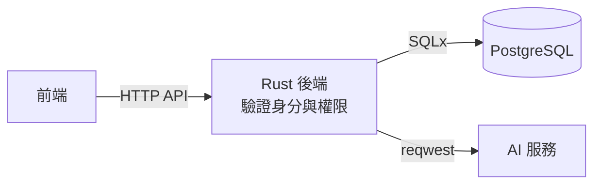

# socrates-chat

蘇格拉底式對話學習系統：學生就哲學題目與 AI 進行多輪討論。系統以追問引導學生釐清立場、檢視理由與假設，而不直接代答；教師可建立討論活動並查看學生的學習成果。系統只服務一門課程，以教室區分不同群的學生，使用資格由各教室的修課名單控制。

> **目前狀態：規格階段。** 功能需求已拆成規格（S-xx）與功能（F-xx）Issues，未定案的產品與技術決策都先由規格 Issue 處理。已確認的決策見 [`docs/specs/decisions.md`](docs/specs/decisions.md)。

## 操作演示


學生選題後與 AI 多輪討論，結束時產生 AI 學習總結；教師在「班上論點分布」看到全班的主張分組與論證傾向。完整畫質見 [`docs/demo/demo.mp4`](docs/demo/demo.mp4)，重新錄製方式見 [`scripts/demo/`](scripts/demo/record.mjs)。

## 技術棧

| 範圍 | 狀態 | 內容 |
| --- | --- | --- |
| 後端 | 已確定 | Rust、Axum、Tokio、SQLx、Serde、reqwest、tracing |
| 資料庫 | 已確定 | PostgreSQL；開發與 CI 用 Docker Compose，正式環境部署待 S-09 |
| 前端 | 已確定（S-11） | React、TypeScript、Vite、Tailwind CSS、shadcn/ui、assistant-ui |
| AI 服務 | 已確定（S-03.1） | OpenAI API（後端以單一介面包裝，模型待評估） |
| 登入 | 已確定（S-01.1） | 內建電子郵件＋密碼（不開放註冊）加 Google 登入；Rust 自行實作，session 存 PostgreSQL |
| 對話傳輸 | 已確定（S-08.4） | HTTP + SSE 串流 |

各套件版本與正式環境部署方式尚未指定。Supabase 與 Redis 不在目前架構內。

### 資料流



前端只呼叫 Rust 後端，不直接存取資料庫或 AI 服務，也不持有資料庫憑證或 AI 服務金鑰。

## 專案結構

```text
.
├── backend/     # Rust + Axum API 服務
├── frontend/    # 前端（見 frontend/README.md）
├── scripts/     # 開發輔助腳本（匯入示範資料、錄製操作演示）
├── .github/     # CI 與 commitlint workflows
├── AGENTS.md    # 給 AI coding agent 的開發指引
├── CONTRIBUTING.md
└── LICENSE      # MIT
```

## 快速開始

```bash
git clone https://github.com/2026software-3/socrates-chat.git
cd socrates-chat
cp .env.example .env    # 填入 GOOGLE_CLIENT_ID、GOOGLE_CLIENT_SECRET、ADMIN_EMAILS、OPENAI_MODEL
cp .apikeylist.example .apikeylist    # 一行一把 AI API key，會輪流使用（可只放一把）
```

### 本地執行（需要 Rust、Node.js、Docker）

```bash
# 終端機 1：資料庫＋後端（http://127.0.0.1:3000）
docker compose up -d db
set -a && . ./.env && set +a
cd backend && cargo run
```

```bash
# 終端機 2：前端（http://localhost:5173）
cd frontend
npm ci
npm run dev
```

### Docker（只需要 Docker）

```bash
docker compose --profile app up --build    # http://localhost:3000
```

兩種跑法都使用 3000 埠，同一時間只能跑其中一種。

### 匯入示範資料（選用）

以 `DEMO_MODE=true` 啟動後端一次（會建立示範教師與 10 位學生，帳號與公開的固定密碼見 [`backend/src/demo_accounts.json`](backend/src/demo_accounts.json)，登入頁也會列出來、點一下填入），再執行（全部是合成資料，不需要管理者密碼）：

```bash
./scripts/seed-demo.sh
```

會建立 3 間教室（含 1 間已封存）、5 個題目、9 個活動（草稿、已發布、已停止開放、預定開放，另有 1 個尚無對話、留給現場示範的活動）、約 26 場對話（已完成的含逐則訊息、AI 總結與主張分組；另有進行中、總結產生中與總結失敗的；也有英文與西班牙文的學生對話）。可重複執行，會先清掉上次的示範資料。**示範模式的密碼是公開的，只用在展示環境**，且示範帳號不含管理者。發表流程與講稿見 [`docs/demo-script.md`](docs/demo-script.md)。

### 錄製操作演示（選用）

匯入示範資料後，用 Playwright 自動操作並錄成 `docs/demo/demo.mp4` 與 `demo.gif`（需要 ffmpeg；學生對話會真的呼叫 AI，產生少量費用）：

```bash
cd scripts/demo
npm install && npx playwright install chromium
npm run record
```

每次錄製都會替學號 `11500001A` 多留一場對話，班上分布的數字會跟著變動。

### 正式環境

正式環境的部署方式尚未決定（S-09）。migration 須在部署前單獨執行、不要依賴 `RUN_MIGRATIONS`，並保持 `COOKIE_SECURE=true`；維運流程見 [`docs/specs/S-09.3-ops-procedures.md`](docs/specs/S-09.3-ops-procedures.md)。

## 參與開發

請先閱讀 [CONTRIBUTING.md](CONTRIBUTING.md)。重點如下：

- 開發主線為 `main`，**禁止直接 push 到 `main`**，所有改動經由 Pull Request 合併。
- 所有 commit 遵守 [Conventional Commits](https://www.conventionalcommits.org/)，CI 會以 commitlint 檢查。
- 採 SDD + TDD：先確認規格與驗收情境，再寫會失敗的測試，最後做最小實作。

使用 AI coding agent 的開發者，請讓 agent 讀取 [AGENTS.md](AGENTS.md)。

## 授權

本專案以 [MIT License](LICENSE) 授權。所使用的開源套件皆為寬鬆授權；複製進原始碼的 shadcn/ui、assistant-ui 與打包的 Geist 字型所需的聲明見 [docs/THIRD-PARTY-NOTICES.md](docs/THIRD-PARTY-NOTICES.md)。
