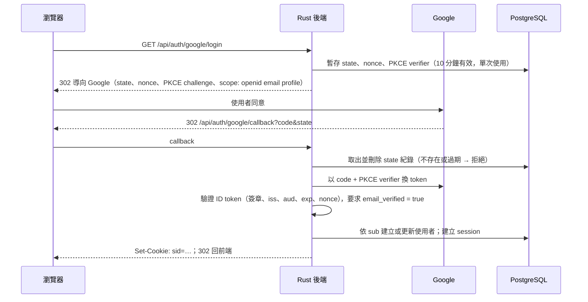

# S-08.2 登入憑證驗證與身分映射

> **狀態：已確認（2026-09-29），2026-10-04 補入內建登入。** 依據已確認的 S-01.1（內建電子郵件＋密碼與 Google 登入並存、不開放註冊、session 存 PostgreSQL）、S-01.2（以電子郵件識別，Google 另綁 `sub`）、S-01.3（管理者建立教師、`ADMIN_EMAILS`）、S-01.4（修課名單）。
>
> **2026-10 修訂（學號登入）：** 依 `decisions.md` 的 S-01.1、S-01.2、S-01.4 修訂：學生以**學號**為識別鍵、電子郵件選填；登入帳號欄接受學號或電子郵件；登入失敗限流改以（登入帳號輸入, 來源 IP）為單位。該決定由規格 PR #406 合併後生效，本文件修訂需與其一併合併。

## 1. 內建登入（學號或電子郵件＋密碼）

**不開放自行註冊**：沒有註冊頁與註冊 API。內建帳號只由系統建立：

| 帳號 | 建立時機 | 初始密碼 |
| --- | --- | --- |
| 管理者 | 部署時 `ADMIN_EMAILS` 指定的信箱，啟動時建立（需設定 `ADMIN_INITIAL_PASSWORD`；沒設定就只能用 Google 登入） | `ADMIN_INITIAL_PASSWORD`，首次登入須更改；已存在的帳號重啟時不會被重設 |
| 教師 | 管理者新增教師後，以重設密碼端點建立帳號（F-01.2） | 系統自動產生臨時密碼，回給管理者 |
| 學生 | **教師或管理者**匯入修課名單時，為新加入且沒有帳號的學號自動建立，帳號沒有電子郵件（S-01.4） | 系統自動產生臨時密碼，匯入結果一次回給匯入者（`credentials`）；學號已有帳號的，不建立、不重設 |

**教師匯入名單也建立帳號並取得臨時密碼**（2026-10 需求方決定，修訂原「教師匯入只加名單、不建立帳號」）：沒有電子郵件的學生只能以學號加密碼登入，教師必須能把臨時密碼交給學生，因此教師與管理者匯入時都會為新學號建立內建帳號，臨時密碼在匯入結果中一次回給匯入者。

> **已接受的風險：** 教師因此在學生首次登入並改密碼之前，知道該學生的臨時密碼，技術上能以學生身分登入，讀到個人練習與進行中的對話（教師本來只能看教室內已結束的活動對話原文，S-02.1）並代學生發言。需求方已接受；緩解只有：臨時密碼只出現一次且之後無法查詢、首次登入強制改密碼（本節下方）、學生改密碼後教師的密碼即失效。是否要加稽核或其他限制尚未決定。

- 臨時密碼由系統自動產生（12 字元、去除易混淆字元、約 60 位元），只在建立當下回應一次，之後無法查詢。
- 使用者以臨時密碼登入後，該 **session** 帶有「須更改密碼」旗標：除了 `GET /api/me`、`POST /api/auth/change-password`、登出之外，其他 API 回 403 `password_change_required`。旗標放在 session 而不是使用者，因為同一個人改用 Google 登入並不知道臨時密碼，不需要被擋。
- `POST /api/auth/change-password`（`current_password`、`new_password`）：驗證目前密碼；新密碼長度 8 到 128 字元（`invalid_new_password`）且不同於目前密碼（`password_unchanged`）；成功後清除旗標，並讓該使用者**其他** session 失效（保留目前這個）。
- 忘記密碼：不寄信，聯絡管理者重設。`POST /api/admin/users/reset-password`（`email`，僅管理者）：沒有帳號就建立，產生新的臨時密碼、清除該使用者所有 session 與登入鎖定，回 `{ email, temporary_password }`。沒有電子郵件的學生改以**學號**指定（S-01.4；學號大小寫不分、轉大寫比對，管理者介面同時顯示姓名與所屬教室名稱供核對），學號須屬於已有帳號的學生，不能憑空建立；請求欄位與回應形式於實作時在 `docs/api/api-reference.md` 定案。
- 密碼以 Argon2id 雜湊保存（`argon2` crate）；長度至少 8 字元，不限制字元種類。
- `POST /api/auth/login`（帳號、password）：帳號欄接受**學號或電子郵件**（欄位名稱為 `account`，舊名稱 `email` 仍可使用，見 `docs/api/api-reference.md`）。成功建立 session（同第 4 節）並回 `{ must_change_password }`；失敗一律回同一個錯誤碼 `invalid_credentials`，不區分「帳號不存在」與「密碼錯誤」，帳號不存在時也做一次假的雜湊比對以避免時間差。
  - **帳號比對**：先去前後空白；含 `@` 者以電子郵件比對（轉小寫）；否則符合學號格式（八碼數字加一個英文字母，不分大小寫）者以學號比對（轉大寫）；兩者皆不符視為帳號不存在（仍做假的雜湊比對、仍計入限流）。教師與管理者只有電子郵件，仍以電子郵件登入。
  - 沒有電子郵件的學生只能以學號加密碼登入；學生自己填寫電子郵件後才能使用 Google 登入（第 2 節）。
- 失敗限流（2026-10-25 需求方決定改為「信箱加 IP」，#295；2026-10 因學號登入，單位改為「登入帳號輸入加 IP」）：以（**登入帳號輸入**, 來源 IP）為單位計，連續失敗 5 次鎖定 15 分鐘，期間即使密碼正確也拒絕並回 429 `too_many_attempts`。登入帳號輸入先**正規化**再計（去前後空白；含 `@` 者轉小寫，否則轉大寫），因此大小寫變化不能繞過計數；不論帳號是否存在、輸入是學號還是電子郵件都計，避免洩漏。因此：別的 IP 亂試某人的學號或信箱，不會把本人鎖在門外；同一個 IP（例如校園 NAT）後面不同帳號的失敗也互不影響。成功登入只清除該（帳號輸入, IP）的計數；管理者重設密碼、使用者改密碼會清除該帳號所有登入帳號輸入（學號與電子郵件）在所有 IP 的計數；鎖定到期歸零。鎖定狀態存 PostgreSQL（`login_failures`）；鍵中的登入帳號輸入以**雜湊**保存，不存學號或電子郵件明文（學號屬敏感欄位，S-02.2）。沒有連線資訊時（例如測試）來源 IP 視為空字串，退回只以登入帳號輸入計。
  - **每登入帳號輸入跨 IP 總量上限**（2026-10-25 需求方決定加入，原為每信箱）：同一（正規化後的）登入帳號輸入不論來源 IP，累計失敗 30 次（**暫定值，待確認**）就在所有 IP 鎖定 15 分鐘，限制分散式（多個 IP 各猜幾次）的猜密碼。成功登入或管理者重設密碼會清除；鎖定到期歸零。
  - **已知取捨**：這個上限讓攻擊者有辦法用足夠多的 IP 把某個登入帳號（學號或信箱，包括管理者）鎖住 15 分鐘，本人也暫時無法用密碼登入。同時有學號與電子郵件的學生有兩個登入帳號輸入，計數各自獨立，攻擊者的總嘗試額度因此加倍（各自仍受上限約束）；這是單位改為「登入帳號輸入」的直接結果，目前接受。緩解：只鎖密碼登入，Google 登入不受影響；管理者重設密碼會立即解鎖；數值遠高於（信箱, IP）的 5 次，單一來源碰不到。逐步加延遲不採用：在請求中 `sleep` 擋不住並行請求，要真的限速得為每個信箱做序列化並佔住連線，反而成為資源耗盡的攻擊面。
- 請求頻率限制（`tower_governor`，需求方 2026-10-25 同意使用）：`POST /api/auth/login` 依來源 IP 限制請求頻率，一次最多連續 60 個、之後每 3 秒回補一個，即平均每分鐘 20 個（**暫定值，待確認**；2026-11 由每 0.5 秒一個收緊持續速率，瞬間額度維持 60 以免整班同時登入被誤擋；可用 `LOGIN_RATE_BURST`、`LOGIN_RATE_REPLENISH_SECS` 調整），超過回 429 `too_many_attempts`（同一格式，前端不用改）。這只擋洪水式請求，不是猜密碼的防護；額度刻意放寬，避免校園 NAT 下一整個班共用一個 IP 時被誤傷。計數放在記憶體，重啟後歸零。
- 來源 IP 判定：預設取 TCP 連線對端。只有對端落在環境變數 `TRUSTED_PROXIES`（逗號分隔的 CIDR，預設空）列出的反向代理網段時，才採用 `X-Forwarded-For`，且由右往左取第一個不屬於受信任代理的位址（代理追加的在右邊，左邊可能是用戶端偽造的）；標頭無法解析時退回對端位址。直連者自己填的標頭一律忽略。IPv4 mapped IPv6 視為 IPv4；IPv6 以 /64 前綴為單位。
  - 部署時的陷阱（以 Docker 加 Tailscale Funnel 實測）：Funnel 會用真實來源覆寫 `X-Forwarded-For`（用戶端偽造的會被蓋掉），但後端在 Docker 內時，從主機轉入的連線對端是 bridge 閘道（例如 `172.29.0.1`），不是 `127.0.0.1`，也看不出是 Funnel 還是直連。因此沒有可信代理時，所有人會共用同一組（信箱, IP）與同一個頻率額度；設了 `TRUSTED_PROXIES` 時，後端必須只對代理開放（綁 `127.0.0.1`），否則直連者可偽造標頭。正式環境的代理架構待 S-09.1 決定（待確認）。
  - IP 屬個資：資料表只存限流用的鍵（IPv6 為 /64 前綴），每次記錄失敗時順便清掉一天前的資料；正式的保存期限待與 S-02.5 對齊（待確認）。日誌不記錄 IP 與登入帳號輸入（學號、信箱）的對應。
- 密碼、臨時密碼與雜湊不得出現在日誌、API 回應與稽核日誌中；日誌與錯誤回應也不得出現學號。

## 2. Google 登入流程（OIDC Authorization Code + PKCE）

使用 `openidconnect` crate（底層為 reqwest），它會驗證 ID token 的簽章、`iss`、`aud`、`exp` 與 `nonce`。

- 使用者取消授權，或 Google 回傳錯誤時：導回前端登入頁並附錯誤代碼，不建立 session。
- Google 的 client secret 只存在後端的環境變數（S-08.3、S-09.2）。
- Google 登入成功後，依電子郵件找使用者：找到就綁定 `sub`（已綁定則以 `sub` 為準）；找不到就建立新使用者（沒有密碼，角色判定同第 3 節，名單外看到「尚未開通」）。**沒有電子郵件的學生帳號不會被比對到**，學生自己填寫電子郵件（教師與管理者不能代填，匯入也不會補上，S-01.4）後才能以 Google 登入。

## 3. 身分映射

| 資料 | 規則 |
| --- | --- |
| 使用者識別 | 學生以**學號**為識別鍵（八碼數字加一個英文字母，儲存一律大寫、全域唯一，S-01.2）；教師與管理者以電子郵件。電子郵件有值時轉小寫後唯一，學生可為空；`users.google_sub`（唯一、可為空）在 Google 登入時綁定 |
| 電子郵件 | 內建帳號以建立時的值為準；Google 登入時，已綁定 `sub` 的使用者以 Google 回傳值更新。學生可以沒有電子郵件 |
| 學號 | 學生必填，教師與管理者為空；可見範圍見 S-01.4、S-02.2（管理者不遮蔽學號） |
| 密碼 | `users.password_hash`（可為空，表示尚未設定）、`must_change_password` |
| 顯示名稱 | **學生**的預設顯示名稱是匯入名單時的姓名（S-01.4，存在帳號上）；教師與管理者的內建帳號由建立者填寫、Google 帳號第一次登入時取自 `name`；學生可自行修改（`PATCH /api/me`），規則見下 |

**顯示名稱規則**
- Google 名稱只是預設值：**只在顯示名稱為空時才填入**，使用者自訂的名稱不會被覆寫。教師與管理者清除名稱後，內建帳號會一直顯示電子郵件，Google 帳號則在下次 Google 登入時重新取自 Google。
- **學生清除顯示名稱後，一律改回匯入的姓名**（2026-10 需求方決定，內建與 Google 帳號都一樣；學生的顯示名稱因此不會是空的，Google 的 `name` 不會取代匯入的姓名）。匯入的姓名在建立帳號時寫入，之後的匯入不更新既有帳號的姓名；同一學號在不同教室匯入不同姓名時以第一次為準（2026-10 需求方決定）。
- 學生可自行修改（`PATCH /api/me`），目前只有學生能改。去頭尾空白後最多 30 個字元（以 Unicode 字元計，不是位元組；2026-10 需求方調整，與匯入姓名的上限一致，S-01.4）。
- 不可包含控制字元（換行、tab、NUL 等，`char::is_control`）與行／段落分隔字元（U+2028、U+2029），其他字元不限制。
- 空字串或 `null` 表示清除：學生回到匯入的姓名；教師與管理者回到顯示電子郵件。
- 已知風險：零寬字元與雙向控制字元（RTL override）等格式字元仍可使用；不當名稱審查待 S-02.3 決定。
- 名稱會顯示在雷達圖（S-02.3）與教師的學生清單。

**角色判定**（每次請求由 session 載入，不存在 cookie 裡）：

| 角色 | 條件 |
| --- | --- |
| 管理者 | 電子郵件在 `ADMIN_EMAILS` 中，首次登入時授予並寫入資料庫；之後由資料庫記錄為準 |
| 教師 | 電子郵件在管理者建立的教師清單中（F-01.2）；帳號已登入過時立即生效 |
| 學生 | 該帳號（學號或電子郵件）在修課名單中（S-01.4） |
| 尚未開通 | 以上皆非 → 只能看「尚未開通」頁面 |

一個使用者可以同時具備多個角色，例如管理者也是教師。**教師與管理者不需要在修課名單內。**

## 4. Session

| 項目 | 規格 |
| --- | --- |
| Token | 256 位元隨機值；資料庫只存 SHA-256 雜湊，不存原值 |
| Cookie | `sid`；`HttpOnly`、`Secure`、`SameSite=Lax`、`Path=/` |
| 有效期 | 閒置 7 天失效、絕對上限 30 天；每次使用時更新 `last_seen_at` |
| 登入時 | 一律建立新 session（防止 session fixation） |
| 登出 | 刪除該 session 紀錄並清除 cookie |
| 角色變更或名單移除 | 立即生效，因為角色是每次請求從資料庫載入 |

**CSRF 防護**：`SameSite=Lax` 加上檢查 `Origin` 標頭。所有會改變狀態的請求（POST、PUT、PATCH、DELETE），`Origin` 都必須等於本站網域，否則拒絕。

## 5. 後端授權實作

- `CurrentUser` extractor：讀 cookie → 雜湊 → 查 session 與使用者角色；找不到或過期時回 401。
- 各角色的守門以 extractor 或 middleware 表示，例如 `RequireStudent`、`RequireTeacher`、`RequireAdmin`。未通過回 403，錯誤格式依 S-08.1。
- 名單外帳號呼叫學生 API 時回 403，錯誤碼為 `not_enrolled`，前端依此顯示「尚未開通」。

## 6. Given / When / Then

- Given 帳號密碼正確，When `POST /api/auth/login`，Then 建立新 session 並設定 cookie。
- Given 帳號（學號或電子郵件）不存在或密碼錯誤，Then 兩者回應相同（`invalid_credentials`）。
- Given 學生輸入 `11234567a` 與正確密碼，Then 以學號 `11234567A` 比對並登入成功（不分大小寫）。
- Given 帳號欄含 `@`，Then 以電子郵件比對；Given 帳號欄符合學號格式，Then 以學號比對；Given 兩者皆不符，Then 回 `invalid_credentials`。
- Given 教師或管理者，Then 仍以電子郵件登入，學號登入對他們無效。
- Given 沒有電子郵件的學生，When 以學號加密碼登入，Then 登入成功；When 嘗試 Google 登入，Then 比對不到該帳號，學生自己填寫電子郵件後才能使用。
- Given 同一登入帳號輸入從同一個 IP 連續失敗 5 次，Then 該（帳號輸入, IP）鎖定 15 分鐘，期間正確密碼也被拒絕。
- Given 同一學號分別以 `11234567a` 與 `11234567A` 輸入失敗，Then 計入同一個計數（正規化後相同）。
- Given 某登入帳號輸入被其他 IP 亂試失敗但未達跨 IP 總量上限，When 本人從另一個 IP 以正確密碼登入，Then 不被鎖在門外。
- Given 同一登入帳號輸入從許多不同 IP 累計失敗達總量上限，Then 該輸入在所有 IP 鎖定 15 分鐘（正確密碼也拒絕）；成功登入、管理者重設密碼或到期會解除；其他帳號不受影響。
- Given 同一個 IP 對許多不同登入帳號輸入各失敗幾次，Then 不會鎖住整個 IP，其他帳號仍可正常登入。
- Given 成功登入，Then 只清除該（帳號輸入, IP）的計數；Given 管理者重設密碼，Then 該帳號所有登入帳號輸入（學號與電子郵件）在所有 IP 的計數都清除。
- Given 登入失敗，Then 日誌、錯誤回應與限流資料表都不含學號明文。
- Given 同一 IP 短時間內送出超過頻率額度的登入請求，Then 回 429 `too_many_attempts`，其他 IP 不受影響。
- Given 沒有設定 `TRUSTED_PROXIES`，或請求不是從受信任代理來的，When 請求帶有偽造的 `X-Forwarded-For`，Then 標頭被忽略，仍以 TCP 對端計算。
- Given 請求來自受信任代理，When `X-Forwarded-For` 左側有偽造的項目，Then 取最右側不屬於受信任代理的位址。
- Given 沒有註冊端點，When 請求 `/api/auth/register` 之類路徑，Then 回 404。
- Given 使用者以臨時密碼登入，When 呼叫其他 API，Then 回 403 `password_change_required`，更改密碼後才放行。
- Given 管理者重設某使用者的密碼，Then 該使用者所有 session 立即失效。
- Given 帳號只用過 Google 登入、沒有密碼，When 以內建登入，Then 回 `invalid_credentials`。
- Given 內建帳號（匯入名單或管理者重設建立）的信箱，When 用同信箱的 Google 登入，Then 綁定 `sub` 並登入同一個使用者，且不受 `password_change_required` 限制。
- Given 教師或管理者匯入名單，Then 只有新加入、沒有帳號、且不是教師／管理者的學號會取得臨時密碼，一次回給匯入者；再次匯入不會重發。
- Given 學號已有帳號（例如其他教室已匯入過），When 另一位教師匯入同一學號，Then 不建立、不重設、不回臨時密碼。
- Given 內建帳號仍是臨時密碼（從未更改），When 該信箱的 Google 登入綁定，Then 臨時密碼失效（防止建立者冒用）；使用者自己改過的密碼不受影響。
- Given 信箱在 `ADMIN_EMAILS`、帳號已被搶先建立，When 該信箱首次用 Google 登入，Then 仍成為管理者。
- Given callback 的 `state` 不存在、已使用或過期，When 處理 callback，Then 拒絕並不建立 session。
- Given ID token 的 `aud` 不是本系統的 client ID，或簽章無效，When 驗證，Then 拒絕登入。
- Given Google 回傳 `email_verified = false`，Then 拒絕登入。
- Given 同一個 `sub` 第二次登入，Then 對應同一個使用者，並更新電子郵件。
- Given 電子郵件在 `ADMIN_EMAILS` 中的使用者首次登入，Then 成為管理者。
- Given 名單外、非教師、非管理者的使用者，When 呼叫學生 API，Then 回 403 `not_enrolled`。
- Given session 閒置超過 7 天，When 發出請求，Then 回 401。
- Given 跨站請求（`Origin` 不符）的 POST，Then 回 403。
- Given 學生被移出名單，When 下一次請求，Then 立即失去學生權限。

## 7. 確認結果

1. Session 閒置 7 天失效、絕對上限 30 天。
2. 不限制 Google 帳號的網域，由修課名單把關。
3. 教師身分由管理者建立，不提供自行申請（因此不需要申請表單）。
4. 內建登入與 Google 登入並存；不開放自行註冊；密碼由管理者重設，不寄信。

> 2026-10-04 需求方同意：密碼長度下限 8、鎖定門檻 5 次／15 分鐘、學生臨時密碼自動產生、首位管理者初始密碼環境變數為 `ADMIN_INITIAL_PASSWORD`。
